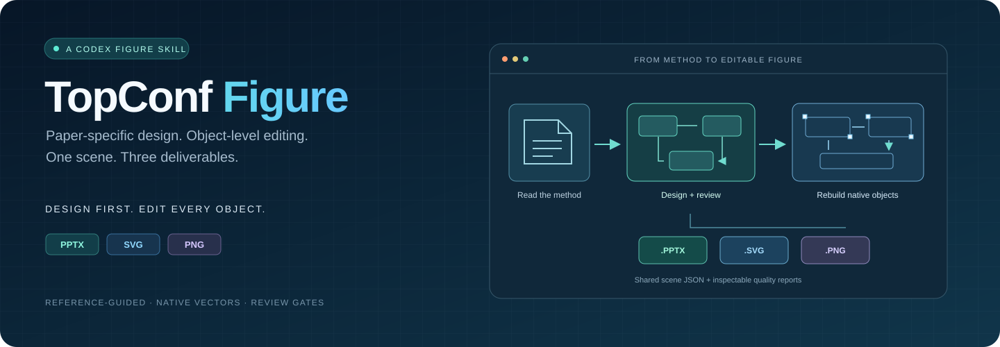
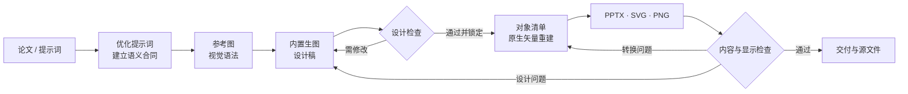
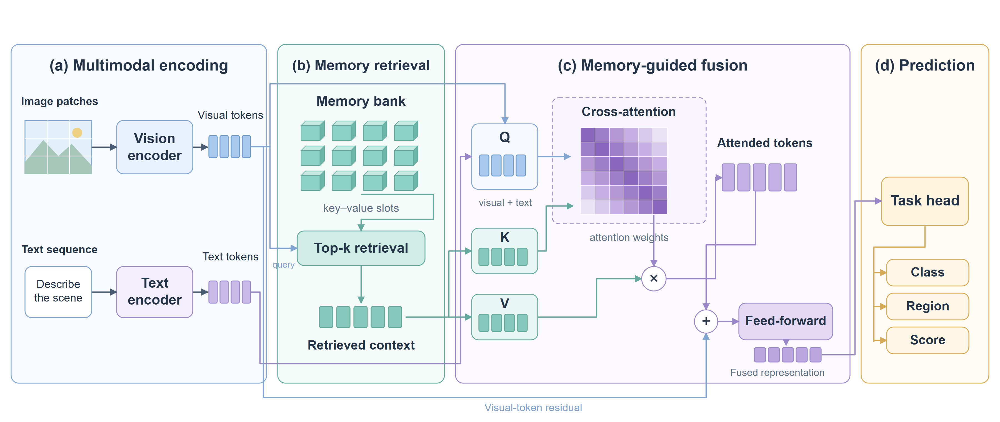

<div align="center">



<p><strong>把论文方法画清楚，也把每个对象留给你编辑。</strong></p>

<p>参考顶会视觉语法 · 先生成设计稿 · 逐对象矢量重建 · 交付 PPTX / SVG / PNG</p>

<p>
  <a href="LICENSE"></a>
  
  
  
</p>

<p><a href="#快速开始">快速开始</a> · <a href="#一张图的制作过程">制作流程</a> · <a href="#可编辑输出示例">输出示例</a> · <a href="#检查与返工">质量检查</a> · <a href="#常见问题">常见问题</a></p>

</div>

---

## 它能做什么

**TopConf Figure** 是面向 Codex 的科研架构图 skill，适合论文方法主图、神经网络结构图、Agent 框架图和系统流程图。给它论文方法、一段提示词或参考图，它会先整理科学关系与画图要求，再设计、重建和检查。

| 你提供 | Skill 完成 | 你拿到 |
| :--- | :--- | :--- |
| 论文方法 / Markdown / 文字描述 | 提炼输入、模块、分支、融合和输出 | 可追溯的绘图说明 |
| 参考图 / 可选本地顶会图库 | 归纳布局、视觉层级、配色和走线 | 针对当前论文的设计稿 |
| 语言、画幅与版式要求 | 内置生图设计 + 原生对象重建 | 可编辑 **PPTX**、矢量 **SVG**、同源 **PNG** |
| 具体修改意见 | 对照设计检查，失败后定向返工 | 场景 JSON、对象清单与检查记录 |

> [!IMPORTANT]
> **先设计，再转换。** 用户要求新设计时，必须实际生成并查看新设计稿；翻译已有图、换标签或复用旧布局，需要明确说明，不能冒充重新生图。将整张图片放进 PowerPoint，也不算对象级可编辑。

## 快速开始

### 1 · 安装 skill

在 Codex 中发送：

```text
使用 $skill-installer，把 https://github.com/neuralsun/topconf-figure-skill
安装为 topconf-figure。该仓库根目录包含 SKILL.md。
```

也可以在你的项目根目录手动安装：

```bash
git clone https://github.com/neuralsun/topconf-figure-skill.git .agents/skills/topconf-figure
```

项目技能目录及 `$skill-installer` 的使用方式见 [OpenAI 官方技能文档](https://learn.chatgpt.com/docs/build-skills)。如当前客户端没有发现技能，按客户端支持的技能目录安装并重新加载。

### 2 · 准备导出环境

在 skill 目录运行，建议使用 Python 3.10+ 和虚拟环境：

```bash
python -m pip install -r requirements.txt
python -m playwright install chromium
```

需要把插画或复杂图标描摹为可编辑曲线时，再安装：

```bash
python -m pip install -r requirements-vector.txt
```

设计阶段需要当前 Codex 会话可用的内置图像生成工具；仅安装 Python 依赖不会自动获得生图能力。Windows + PowerPoint 可用附带脚本做实际 Office 渲染；其他环境可完成导出，但仍需在 Office 中检查排版。中文图需安装相应中文字体。

### 3 · 发出你的第一条绘图指令

```text
使用 $topconf-figure，根据我提供的方法章节画一张英文方法主图。

先优化提示词，核对输入、各模块、工具资源和输出之间的关系。
参考顶会架构图的视觉表达，实际生成新的设计稿，不要只翻译或改旧图。
白底，青蓝主色，橙色表示反馈；不要总标题和图注。

设计检查通过后，保留构图、图标和插画，逐对象重建。
交付可编辑 PPTX、SVG、PNG 和场景源文件。
核对最终图片与 PowerPoint 渲染，发现问题就返回对应步骤修改。

以下是方法内容：
【粘贴方法章节，或提供可访问的本地文件】
```

想先打磨说明而不出图，可以直接说：**“只优化这段绘图提示词，暂时不要生成。”**

## 一张图的制作过程



| 阶段 | 要解决的问题 |
| :--- | :--- |
| **01 / 语义合同** | 讲什么结论？输入是什么？每条分支和箭头是否有材料依据？ |
| **02 / 参考与设计** | 从实际参考中提炼画法，为当前方法重新构图。 |
| **03 / 设计检查** | 检查科学内容、层级、留白、插画、标签与走线；通过后锁定图像哈希。 |
| **04 / 对象重建** | 将卡片、文字、算子、矩阵、张量、插画轮廓和连接线分别重建。 |
| **05 / 导出与复核** | 从一个场景导出三格式，对照设计与实际 Office 渲染检查。 |

生成模型可能拼错文字或画错箭头。可以在设计阶段做有记录的技术校正；校正后的设计预览需重新检查并锁定，不能悄悄把错误带入终稿。

## 可编辑输出示例

下面是仓库自带的**虚构多模态记忆架构**，用于演示原生导出能力；不代表已发表方法或实验结果，也不是所有论文必须套用的模板。



<p align="center">
  <a href="examples/multimodal-memory.pptx"><strong>下载 PPTX</strong></a> ·
  <a href="examples/multimodal-memory.svg"><strong>查看 SVG</strong></a> ·
  <a href="examples/multimodal-memory.png"><strong>查看 PNG</strong></a> ·
  <a href="assets/example.scene.json"><strong>场景 JSON</strong></a>
</p>

| 格式 | 能继续做什么 |
| :--- | :--- |
| **PPTX** | 编辑文字、卡片、矩阵单元、几何图形和连接线；复杂曲线可分组后进入组中修改。 |
| **SVG** | 使用矢量编辑器调整路径、文字与图形，放大不依赖整图位图。 |
| **PNG** | 用于论文预览、幻灯片或其他需要位图的场景；正式 PNG 由最终 SVG 场景渲染。 |
| **scene.json** | 保存坐标、文字、图层、颜色和曲线，便于复现与继续改图。 |

示例的 [结构检查报告](examples/multimodal-memory.qa.json) 由导出器产生。它验证结构与跨格式标签一致性，不是端到端设计质量认证。逐段折线不会自动重排，拖动模块后应检查连线；复杂插画的曲线描摹存在局部近似。

## 检查与返工

**质量检查是程序验证与实际看图的组合。** 不预先填写“全部通过”，也不把主观分数说成自动审美能力。

| 检查层 | 实际检查 |
| :--- | :--- |
| 科学内容 | 材料依据、输入边界、分支关系、工具角色、来源引用及验证范围。 |
| 视觉设计 | 层级、留白、文字大小、箭头走线、图标与插画是否完整。 |
| 文件结构 | 唯一 ID、坐标边界、文字容量、PPTX XML、原生图形及 SVG/PPTX 标签一致。 |
| 最终显示 | 对照设计、最终 PNG 和 Office 渲染，检查遮挡、缺失、字体和箭头。 |

- `PASS`：本阶段要求通过。
- `REDESIGN_REQUIRED`：设计不合格，返回设计。
- `RECONSTRUCTION_REQUIRED`：对象转换或导出不合格，返回重建。

没有实际看过的图，不标注为已检查；没有 Office 渲染条件，就如实记录限制。详见 [质量门说明](references/quality-gates.md)。

## 只运行本地导出

以下命令直接转换仓库示例，不调用模型，也不需要模型 API Key：

```bash
python scripts/export_scene.py assets/example.scene.json --output output/example --png-scale 2
```

得到 `output/example.pptx`、`.svg`、`.png` 和 `.qa.json`。脚本默认拒绝覆盖；确认需要重新导出时使用 `--force`。

Windows 已安装 PowerPoint 时，可进一步运行：

```powershell
powershell.exe -NoProfile -ExecutionPolicy Bypass -File scripts/render_powerpoint.ps1 -InputPptx output/example.pptx -OutputPng output/example-office.png
```

该脚本只读打开要检查的文件，并关闭自己打开的演示文稿。详细参数见 [场景与导出格式](references/scene-format.md)。

<details>
<summary><strong>可选：使用本地顶会参考图库</strong></summary>

可以自行准备 [Top-Conf Figure Gallery](https://github.com/qwdwqfwq/topconf-paper-figure-gallery) 的本地数据目录，再运行：

```bash
python scripts/retrieve_refs.py --gallery /path/to/gallery --query "memory attention fusion" --pattern architecture --limit 9 --output output/references
```

图库根目录需含 `data/figures.json` 与对应图片。脚本执行本地元数据 BM25 检索并生成带出处的联系表；它不是 CLIP 视觉检索。也可将 `config.example.json` 复制为 `config.local.json`，供 Codex 读取本机图库位置。没有图库时可用你提供的参考图。

本仓库不打包论文图片或整套上游图库。参考图片的版权与许可仍归原作者和出版方。

</details>

## 常见问题

**需要自己的 API Key 吗？**

默认工作流使用会话内置推理与图像工具，不要求额外提供 Key。工具是否可用、实际图像模型及使用额度取决于当前客户端和账户；本仓库不承诺免费模型调用，也不在工具不支持选型时声称已强制指定某个模型。

**这是完全离线的吗？**

原生场景转换和本地图库检索在本机运行；Codex 推理与内置生图仍可能由云端处理。要求完全离线时，不应调用云端模型。仓库没有内置第三方生图路由或凭据。

**它与 FigureForge 完全一样吗？**

它提炼了参考检索、视觉归纳、设计和对象重建的思路，是独立的 Codex skill 与本地导出器，不是上游网站的完整复刻，也没有训练或蒸馏模型权重。

**能保证和设计稿一模一样吗？**

目标是保留布局、细节与科学关系。字体、Office 渲染和曲线描摹会有差异，所以需要实际对照；不承诺任意位图的像素级还原。

## 仓库结构

```text
topconf-figure-skill/
├── SKILL.md                    # Codex 工作流入口
├── agents/openai.yaml          # Skill 展示信息
├── scripts/                    # 检索、曲线转换、导出和检查
├── references/                 # 视觉语法、场景格式和质量门
├── assets/example.scene.json   # 可复现的虚构架构场景
├── examples/                   # 示例 PPTX / SVG / PNG
├── docs/assets/hero.svg         # README 视觉封面
├── config.example.json         # 可选图库配置
└── requirements*.txt           # 导出及曲线转换依赖
```

## 来源与许可

流程参考 [qwdwqfwq/topconf-paper-figure-gallery](https://github.com/qwdwqfwq/topconf-paper-figure-gallery)。本仓库脚本独立实现，来源与功能边界见 [provenance.md](references/provenance.md)。项目以 [MIT License](LICENSE) 发布；不包含私人论文、病例材料、模型凭据或论文参考图片。

<p align="center"><sub>Read the method. Design the figure. Keep every object editable.</sub></p>
